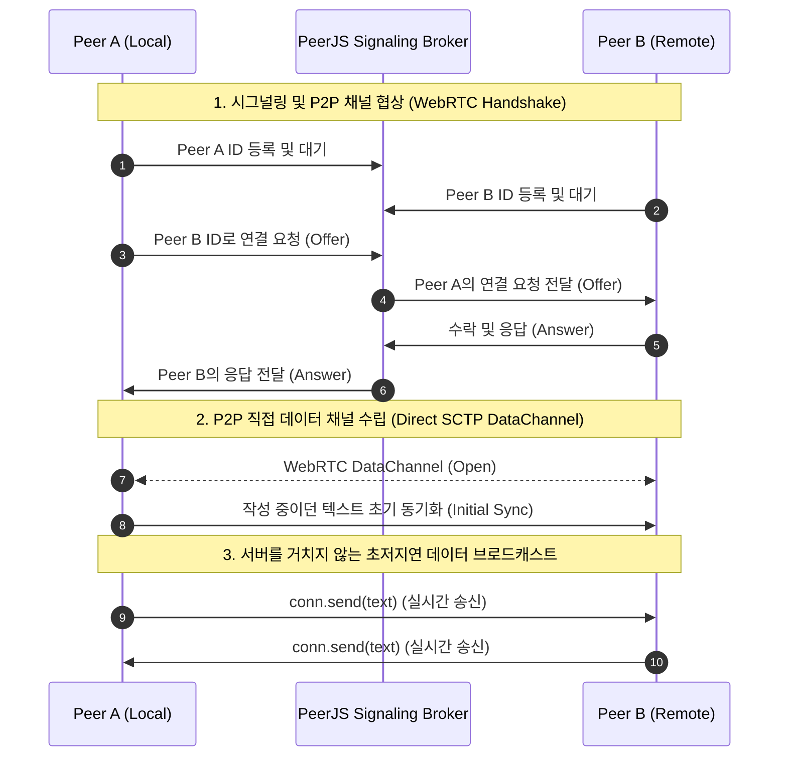

# P2P Web Text Share

> **서버 및 데이터베이스 없이 브라우저 간 WebRTC DataChannel을 통해 텍스트를 실시간으로 공유하는 무서버(Serverless) P2P 웹 애플리케이션**

[](https://vitejs.dev/)
[](https://react.dev/)
[](https://tailwindcss.com/)
[](https://peerjs.com/)
[](https://typoscript.github.io/p2p-web-text-share/)

🌐 **Live Demo**: [https://typoscript.github.io/p2p-web-text-share/](https://typoscript.github.io/p2p-web-text-share/)

---

## 📌 개요 (Overview)

**P2P Web Text Share**는 메시지 중계 서버나 중앙 데이터베이스를 일절 사용하지 않고, 오직 브라우저 내장 기술인 **WebRTC(Web Real-Time Communication)**를 통해 클라이언트와 클라이언트가 1:N으로 직접 연결되어 텍스트 데이터를 밀리초(ms) 단위의 초저지연으로 동기화하는 웹 애플리케이션입니다.

PeerJS 클라우드 시그널링 서버를 통해 브라우저 간 SDP 교환 및 ICE 핸드셰이크만 완료되면, 이후 주고받는 모든 텍스트 데이터는 중간 서버를 거치지 않고 피어 간 종단 간(End-to-End) 암호화 채널로 직접 전송됩니다.

---

## 🚀 주요 기능 (Key Features)

- **순수 P2P 기반 직접 통신 (Zero-Server Architecture)**:
  - 중앙 DB나 백엔드 메시지 브로커 없이 브라우저 간 직접 SCTP 데이터 채널 형성.
- **고유 Peer ID 생성 및 간편 공유**:
  - 접속 즉시 클라이언트 고유 식별자(Peer ID)를 발급받으며, 원클릭 클립보드 복사 지원.
- **1:N 다중 피어 브로드캐스팅**:
  - 1:1 통신에 국한되지 않고, 여러 피어와 동시에 연결하여 텍스트를 실시간 멀티캐스트 전송.
- **상하 2분할 듀얼 패널 인터페이스 (Split-View UX)**:
  - **상단 패널 (송신부)**: 로컬에서 자유롭게 작성 및 편집하는 실시간 입력 공간.
  - **하단 패널 (수신부)**: 연결된 원격 피어들로부터 수신된 최신 텍스트를 **기기별 탭**으로 구분해 렌더링하는 읽기 전용 공간 (전체 복사, 온라인 표시, 새 텍스트 알림).
- **QR 코드 초대**:
  - 초대 링크를 QR 코드로 표시하여 다른 기기의 카메라로 스캔만 하면 즉시 연결.
- **새로고침에도 텍스트 유지**:
  - 입력 중인 텍스트와 수신 텍스트를 브라우저 저장소에 보관하여, 새로고침이나 iOS 탭 복원 후에도 그대로 복원.
- **신규 피어 접속 시 최신 상태 즉시 동기화 (Initial State Sync)**:
  - 새로운 피어가 연결되면 현재 작성된 텍스트 스냅샷을 즉시 자동 전송하여 데이터 연속성 보장.
- **4중 계층 연결 단절 방어 메커니즘 (Fault-Tolerant Connection Tracking)**:
  - 비정상 브라우저 종료, 네트워크 단절, 전송 실패 등 다양한 연결 해제 상황을 다계층으로 감지하여 연결 기기 수를 정확하게 실시간 동기화.
- **고빈도 타이핑 최적화 (High-Frequency Input Optimization)**:
  - `React.memo`와 `useRef` 최신 상태 유지 패턴을 적용하여, 타이핑 시 불필요한 전체 렌더링을 차단하고 60fps 부드러운 반응성 확보.

---

## 🏗️ 시스템 아키텍처 및 데이터 흐름 (Architecture)

### 1. 연결 수립 (Signaling & ICE Handshake)
PeerJS 클라우드 브로커를 통해 최소한의 메타데이터(SDP Offer/Answer, ICE Candidates)만 교환한 뒤, 직접 통신 채널을 오픈합니다.



### 2. 1:N 메시 브로드캐스팅 토폴로지 (Mesh Topology)
각 클라이언트는 자신이 연결한 모든 열려 있는 `DataConnection` 인스턴스를 메모리 상에서 관리하며, `onChange` 이벤트 발생 시 순회하며 데이터를 브로드캐스트합니다.

```
       [ Client A (내가 작성한 텍스트) ]
         /             |             \
  conn.send()     conn.send()     conn.send()
       /               |               \
      v                v                v
 [ Client B ]     [ Client C ]     [ Client D ]
```

---

## 🛠️ 기술 스택 및 채택 이유 (Tech Stack)

| 계층 | 기술 스택 | 버전 | 선정 배경 및 기술적 의의 |
| :--- | :--- | :--- | :--- |
| **Frontend Core** | **React** | `18.3.x` | 컴포넌트 기반 아키텍처, `useCallback`, `useRef`, `memo`를 통한 초저지연 상태 관리 |
| **Build Tool** | **Vite** | `5.4.x` | 초고속 ESM HMR(Hot Module Replacement) 및 최적화된 프로덕션 롤업 번들링 |
| **Styling** | **Tailwind CSS** | `3.4.x` | 유틸리티 퍼스트 CSS를 통한 일관된 다크모드 디자인, GPU 가속 전환(Transition) 효과 |
| **P2P Protocol** | **PeerJS** | `1.5.x` | 브라우저 표준 WebRTC DataChannel API 래핑, ICE/STUN 기반 NAT 통과 및 1:N 연결 관리 |
| **Icons** | **Lucide React** | `1.16.x` | 트리 쉐이킹(Tree-shaking)이 적용된 경량 SVG 아이콘 세트 |
| **CI / CD** | **GitHub Actions** | `v4` | main 브랜치 푸시 시 자동 정적 빌드 및 GitHub Pages (`gh-pages`) 무중단 배포 |

---

## 💡 주요 엔지니어링 고려 사항 (Technical Challenges & Solutions)

### 1. 타이핑 빈도에 따른 렌더링 병목 해결 (Input Performance)
- **문제**: 사용자가 빠른 속도로 타건할 때마다 컴포넌트 전체가 리렌더링되면 가상 DOM 연산 비용이 급증하여 입력 지연(Input Latency)이 발생합니다.
- **해결**:
  - `Header`, `SenderPanel`, `ReceiverPanel` 3개 영역을 독립된 컴포넌트로 분리하고 `React.memo`로 래핑.
  - 브로드캐스트 함수(`broadcastText`)가 `connections` 상태의 변경에 의해 매번 재생성되지 않도록 최신 연결 목록을 `connectionsRef.current`로 추적하여 stale closure 현상 방지 및 무필요 리렌더링 차단.

### 2. 비정상 연결 단절(Unclean Disconnect) 감어 로직 (4-Tier Fallback)
- **문제**: 사용자가 브라우저 탭을 강제 종료하거나 네트워크가 유실될 경우, PeerJS의 `conn.on('close')` 이벤트가 유실되거나 지연되는 현상이 존재합니다.
- **해결**: 4중 감지 체계를 구축하여 즉각 `connections` 배열에서 정리:
  1. `conn.on('close')` & `conn.on('error')` (PeerJS 레벨)
  2. `conn.dataChannel.addEventListener('close')` (WebRTC DataChannel 레벨)
  3. `conn.peerConnection.addEventListener('connectionstatechange')` (`disconnected` / `failed` / `closed` 감지)
  4. 텍스트 송신 시 `conn.send` 예외 포착 및 `!conn.open` 인스턴스 자동 축출

---

## 📂 프로젝트 구조 (Directory Structure)

```text
p2p-web-text-share/
├── .github/
│   └── workflows/
│       └── deploy.yml        # GitHub Actions CI/CD 워크플로우 정의
├── src/
│   ├── App.tsx               # 메인 P2P 로직, 상태 관리, 2분할 UI 컴포넌트
│   ├── main.tsx              # React DOM 렌더 진입점
│   ├── iceConfig.ts          # STUN/TURN ICE 서버 구성 로더 및 연결 경로 진단
│   ├── storage.ts            # 입력/수신 텍스트 저장·복원 (sessionStorage 탭별 + localStorage)
│   ├── components/
│   │   ├── ReceiverPanel.tsx # 기기별 탭 수신 패널 (복사, 온라인 표시, 새 텍스트 알림)
│   │   └── QrInviteModal.tsx # 초대 링크 QR 코드 모달
│   ├── vite-env.d.ts         # Vite 클라이언트 타입 선언
│   └── index.css             # Tailwind 디렉티브 및 100dvh 레이아웃/스크롤바 스타일
├── index.html                # 루트 HTML 템플릿
├── .env.example              # TURN 릴레이 환경 변수 예시
├── vite.config.ts            # Vite 빌드 및 GitHub Pages base 경로('/p2p-web-text-share/') 설정
├── tsconfig.json             # TypeScript 프로젝트 references (app / node)
├── tsconfig.app.json         # src 대상 strict TS 설정
├── tsconfig.node.json        # vite.config.ts 대상 TS 설정
├── tailwind.config.js        # Tailwind CSS 설정
├── postcss.config.js         # PostCSS 플러그인 구성
├── package.json              # 의존성 및 스크립트 정의
├── claude.md                 # 에이전트 공통 맥락 & 규칙 문서
├── agents.md                 # claude.md와 100% 동기화되는 규칙 문서
└── README.md                 # 프로젝트 기술 명세서
```

---

## 💻 로컬 개발 환경 실행 (Getting Started)

### 요구 사양
- **Node.js**: `v18.0.0` 이상 (v20 권장)
- **npm**: `v9.0.0` 이상

### 1. 저장소 클론
```bash
git clone https://github.com/typoscript/p2p-web-text-share.git
cd p2p-web-text-share
```

### 2. 패키지 설치
```bash
npm install
```

### 3. 로컬 개발 서버 기동
```bash
npm run dev
```
브라우저에서 `http://localhost:5173/` 접속 후, 서로 다른 탭이나 창 2개를 열어 P2P 연결을 테스트할 수 있습니다.

### 4. 프로덕션 빌드
```bash
npm run build
```

### 5. TURN 릴레이 설정 (선택)
LTE/5G 등 대칭형 NAT 환경에서는 STUN만으로 연결이 실패할 수 있어 TURN 릴레이가 필요합니다.

- **로컬**: `.env.example`을 `.env.local`로 복사한 뒤 값을 입력합니다.
- **배포**: GitHub 저장소 `Settings → Secrets and variables → Actions`에 같은 이름의 Secret을 등록하면 빌드 시 주입됩니다.

| 변수 | 설명 |
|---|---|
| `VITE_TURN_CREDENTIALS_URL` | `RTCIceServer[]` JSON을 반환하는 자격 증명 API (예: Metered `https://<앱>.metered.live/api/v1/turn/credentials?apiKey=<KEY>`) |
| `VITE_TURN_URLS` / `VITE_TURN_USERNAME` / `VITE_TURN_CREDENTIAL` | 고정 TURN 서버 정보 (URL은 쉼표 구분). API가 없거나 실패 시 사용 |

> `VITE_` 값은 빌드된 JS에 포함되어 공개되므로, 사용량 제한이 있는 무료/전용 키만 사용하세요. 설정이 없으면 STUN만으로 동작하며, 실제 연결 경로(직접/STUN/TURN 릴레이)는 앱의 **로그** 패널에서 확인할 수 있습니다.

---

## 📄 라이선스 (License)

This project is licensed under the MIT License - see the LICENSE file for details.
